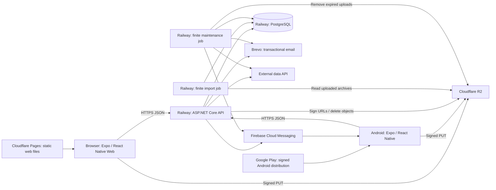

# Cross-platform application guidelines

A practical architecture, implementation, and deployment reference derived from Heteroboxd.

**Source baseline:** repository revision `8769372`, inspected on 2026-11-13. Paths in this document are relative to the Heteroboxd repository root. In another project, substitute that project's names and paths.

**Deployment baseline:** an ASP.NET Core API, an import job, a maintenance job, and PostgreSQL run as separate Railway services; an Expo web export runs on Cloudflare Pages; Android is built locally into a signed Android App Bundle and uploaded manually to Google Play. EAS Build, EAS Submit, and an Expo-hosted backend are not required.

**Database ownership policy:** the application intentionally does not use EF Core migrations. The user owns schema and index definitions and executes database-administration SQL manually in pgAdmin. AI agents, builds, deployments, and backend processes must not create or alter the schema or indexes. `DbContext` supplies EF Core mappings for the user-managed database; it does not change the database on build.

This document treats Heteroboxd as an application. Names of existing source files appear only to identify implementation examples. Product-specific entities, branding, content, external datasets, and business rules are not a template for an unrelated project.

## Contents

1. [How to apply this guide](#1-how-to-apply-this-guide)
2. [Architecture and hosting decisions](#2-architecture-and-hosting-decisions)
3. [Technology and dependency policy](#3-technology-and-dependency-policy)
4. [Repository and ownership boundaries](#4-repository-and-ownership-boundaries)
5. [Configuration and environment contract](#5-configuration-and-environment-contract)
6. [Backend implementation](#6-backend-implementation)
7. [Database mapping and manual schema administration](#7-database-mapping-and-manual-schema-administration)
8. [Authentication and authorization](#8-authentication-and-authorization)
9. [External integrations](#9-external-integrations)
10. [Background processing](#10-background-processing)
11. [Frontend implementation](#11-frontend-implementation)
12. [Local setup and development](#12-local-setup-and-development)
13. [Railway deployment](#13-railway-deployment)
14. [Cloudflare Pages deployment](#14-cloudflare-pages-deployment)
15. [Manual Android delivery](#15-manual-android-delivery)
16. [Coding practices and change workflow](#16-coding-practices-and-change-workflow)
17. [Verification and release sequencing](#17-verification-and-release-sequencing)
18. [Operations, recovery, and scaling](#18-operations-recovery-and-scaling)
19. [Decision reference for agents](#19-decision-reference-for-agents)
20. [Known limits and source map](#20-known-limits-and-source-map)

## 1. How to apply this guide

Four kinds of statements are deliberately separated:

- **Observed:** behavior established by the checked-in implementation.
- **User-established policy:** intentional decisions supplied by the project owner, including manual database administration through pgAdmin and the prohibition on agent/runtime schema changes.
- **Deployment baseline:** the hosting arrangement specified above. Account settings, live service configuration, database contents, signing credentials, and deployed artifacts were not inspected.
- **Rule for a new project:** an implementation recommendation derived from the architecture, including necessary corrections where the reference has a limitation.

Production use is evidence that an architecture can support a real application. It is not evidence that every line is a security, reliability, or reproducibility best practice. Preserve the useful boundaries and small operational footprint; do not reproduce omissions simply because they occur in the reference.

When starting another project:

1. Identify its users, data ownership, supported devices, expected workload, and hosting constraints.
2. Use the API, shared library, database, and Expo client as the initial shape.
3. Add an independently deployed job only when there is actual work that should outlive an HTTP request.
4. Choose supported, mutually compatible dependency versions. The version inventory below describes the reference, not a permanent installation prescription.
5. Implement one complete path through UI, API, persistence, and error handling before adding infrastructure.
6. Keep this guide as a decision reference. Record deliberate departures and their reasons in the new project's own documentation.

Do not introduce a message broker, distributed cache, generic repository framework, separate backend for each client, code generator, or workspace orchestrator without a concrete requirement. Do not omit ownership checks, compatibility with the user-managed schema, signing continuity, or recovery procedures to make the project appear simpler. Do not introduce migrations to replace the owner's deliberate pgAdmin workflow.

## 2. Architecture and hosting decisions

### 2.1 Runtime topology



The external-client and push registrations exist in both the API and maintenance compositions. A registered integration does not imply every process invokes it on every execution; several maintenance synchronization calls are currently disabled.

The compiled `Shared` library belongs inside all three backend executables. It is not another running service. The clients communicate with the API over HTTP; they do not load C# types or connect to PostgreSQL.

### 2.2 Responsibility and state

| Component | Owns | Does not own |
| --- | --- | --- |
| Expo client | Rendering, navigation, form interaction, local caches, session presentation, device features | Database credentials, authoritative permissions, provider secrets |
| API | Public HTTP contract, identity, authorization, application operations, upload authorization | Serving the frontend, lengthy archive processing |
| Shared library | EF context, entities, DTOs, repositories, reusable provider adapters | HTTP routing, UI state, independent deployment |
| Import job | Processing accepted uploaded work and recording status | Interactive request handling |
| Maintenance job | Cleanup, reconciliation, scheduled synchronization, completion reporting | A permanent HTTP listener |
| PostgreSQL | Durable application records, identity data, refresh tokens, notification records, job state | Binary uploads and client bundles |
| R2 | Uploaded binary objects | Application permissions or job scheduling |
| Pages | Public HTML, JavaScript, CSS, images, release metadata | Private configuration or application server execution |
| Play | Distribution of signed native releases | API deployment or automatic adoption of every new client version |

Durable truth lives in PostgreSQL and object storage. React state, AsyncStorage caches, process memory, and container files are replaceable. Treat a container restart as normal.

### 2.3 Why this split fits the selected hosts

**One backend application, multiple process lifetimes.** The three executable projects share a schema and code. This is a shared application deployed in several processes, not a set of independently owned microservices. Keep interactive requests short while running expensive or periodic work separately.

**Railway containers.** Each executable has a Dockerfile. The API listens on `0.0.0.0` and the platform's `PORT`. Jobs start, perform work, and exit. PostgreSQL is reachable from the backend over the platform network. This avoids running a general-purpose VM or installing runtimes manually on a server.

**Cloudflare Pages.** The web client is an exportable directory. No frontend server needs to remain running. This requires a browser-safe client, deliberate dynamic-route handling, public build-time configuration, and a separately reachable API.

**Cloudflare R2.** Clients upload directly using short-lived signed URLs. The API authorizes transfers without relaying all file bytes or retaining uploads on its local disk. Storage policy and browser upload CORS remain separate from API CORS.

**Local Android builds.** Expo config and plugins generate a native project; Gradle produces the release artifact. The team controls toolchain installation, signing, build verification, and Play submission. Expo libraries remain useful without outsourcing builds to EAS.

**Shared UI, selective platform differences.** React Native primitives serve both Android and the browser. Native modules are isolated where their lifecycle or availability differs. Platform support means tested behavior, not merely a platform entry in configuration.

These are architectural rationales inferred from the code and deployment baseline, not a claim about the author's original motivations or measured hosting costs.

## 3. Technology and dependency policy

### 3.1 Observed stack

| Area | Reference configuration | Purpose |
| --- | --- | --- |
| Backend runtime | C#, `net9.0` in all four projects | API and finite console jobs |
| HTTP API | ASP.NET Core controllers and built-in DI | Routing, authentication, authorization, configuration, logging |
| Identity | ASP.NET Core Identity with GUID keys | Users, password hashing, password-reset tokens |
| Access tokens | JWT bearer authentication, HMAC SHA-256 | One HTTP authentication model across web and Android |
| Persistence | EF Core `9.0.9` and Npgsql EF provider `9.0.4` | PostgreSQL access and relational mapping |
| Bulk processing | EFCore.BulkExtensions `9.0.1`, PostgreSQL-specific package in jobs | Batched inserts and updates |
| Object storage | AWSSDK.S3 `4.0.18` | R2 through its S3-compatible API |
| Push | FirebaseAdmin `3.4.0` | Direct server-to-FCM delivery |
| Provider JSON | Newtonsoft.Json `13.0.4`; System.Text.Json also used | Existing external DTOs and platform JSON operations |
| Archive parsing | CsvHelper `33.1.0` and .NET ZIP APIs | Uploaded archive ingestion |
| Other backend dependency | HtmlAgilityPack `1.12.4` is declared | Inventory item; declaration alone does not prove an active use |
| Frontend language | JavaScript, JSX, ES modules | No TypeScript application setup in the tracked tree |
| Expo | `~55.0.19` | Native capabilities, development, prebuild, export |
| Rendering | React/React DOM `19.2.0`, React Native `0.83.10`, React Native Web `~0.21.0` | Shared component model |
| Routing | Expo Router `~55.0.7`; entry `expo-router/entry` | File-based screens and navigation |
| Local persistence | AsyncStorage `2.2.0` | Session tokens, small caches, search history |
| Motion/input | Gesture Handler `~2.30.0`, Reanimated `4.2.1`, Worklets `0.7.4` | Native gestures and animation |
| UI foundations | Safe Area Context, Screens, React Native Paper, Modal, Masked View | Insets, navigation support, selected UI behavior |
| SVGs | react-native-svg `15.15.3` and SVG transformer `^1.5.3` | Repository-owned SVG assets as components |
| Content rendering | react-native-render-html `^6.3.4` | Existing formatted-content display |
| Other client utilities | jwt-decode, flag-icons, Expo device/media/font/linking/notification modules | Specific application capabilities |

The individual Expo packages in `package.json` use compatible `55.x` ranges. Read that manifest for exact declared ranges. A range is not an installed-version inventory.

**Version selection rule:** reproduce a baseline only when necessary for compatibility; start a new project on a supported stack. On this document's inspection date, Microsoft's policy lists .NET 9 as out of support as of 2026-11-10. Do not adopt `net9.0` for a new production application solely because this repository uses it. Upgrade SDK, target frameworks, EF/Npgsql compatibility, and Docker images together. Consult the current [Microsoft support policy](https://dotnet.microsoft.com/en-us/platform/support/policy/dotnet-core).

### 3.2 Library inclusion policy

The repository has no standalone dependency-policy document. The following policy captures its useful preference for small helpers, platform facilities, and a limited set of focused libraries:

1. Reuse the project's existing component, helper, repository method, or integration boundary.
2. Use language/runtime facilities for ordinary work: `fetch`, URL encoding, arrays/maps/sets, .NET cryptography, ZIP streams, LINQ, DI, configuration, logging.
3. Use an already installed library for a task it handles well.
4. Add a dependency when the capability is substantial or platform-sensitive: native notifications, gestures, image manipulation, database access, standards-compliant CSV parsing, provider signing.
5. Reject a new library that merely saves a handful of clear lines, duplicates an existing dependency, or requires a new runtime service without an established need.

Before adding a package, check:

- Compatibility with the selected Expo SDK, React Native architecture, Metro, Android release builds, and static web export.
- Whether importing it at module scope touches `window`, `document`, device APIs, or native modules during static rendering.
- Maintenance status, license obligations, transitive dependencies, security advisories, bundle/binary growth, and provider lock-in.
- Whether an official SDK is worth its cost. R2 signing and Firebase use SDKs; Brevo uses a small `HttpClient` adapter.
- Whether a config plugin, new Android permission, Gradle change, or fresh native build is required.
- Whether a package belongs in a single executable or the shared library. A dependency in `Shared` reaches every backend process.

Use `npx expo install <package>` for Expo/native dependencies so version selection follows the SDK. Do not update React Native, React, Reanimated, and native packages independently to their latest versions.

Every package imported directly by application code should be a declared direct dependency. The reference imports `expo-file-system/legacy` and `@expo/config-plugins` without listing them as direct dependencies; their availability through the dependency tree is not a reproducible policy for a new project.

### 3.3 Reproducibility

**Observed:** frontend `package-lock.json` is ignored, no lockfile is tracked, no Node version pin is tracked, and no `global.json` pins the .NET SDK. NuGet package versions are specified in project files. Native directories are ignored.

**Rule for a new project:** commit one package-manager lockfile and use its frozen installation mode in deployment. For npm this means a reviewed `package-lock.json` and `npm ci`. Pin the Node and .NET SDK versions used by local and hosted builds. Keep generated native customization reproducible through config/plugins or a fully documented native-source workflow.

For this unmodified reference, a clean checkout uses `npm install`; advertising `npm ci` without supplying a lockfile would be incorrect. A successful build on one developer's machine does not establish that a fresh checkout can reproduce it.

## 4. Repository and ownership boundaries

### 4.1 Layout

```text
/
├── GUIDELINES.md
├── README.md
├── LICENSE
├── id_script.py
├── backend/
│   ├── Heteroboxd.sln
│   ├── Heteroboxd.API/
│   │   ├── Program.cs
│   │   ├── Controller/
│   │   ├── Service/
│   │   ├── Heteroboxd.API.csproj
│   │   └── Dockerfile
│   ├── Heteroboxd.Shared/
│   │   ├── Data/
│   │   ├── Models/
│   │   │   ├── DTO/
│   │   │   └── Enums/
│   │   ├── Repository/
│   │   ├── Integrations/
│   │   └── Heteroboxd.Shared.csproj
│   ├── Heteroboxd.Import/
│   │   ├── Program.cs
│   │   ├── Background/
│   │   ├── Heteroboxd.Import.csproj
│   │   └── Dockerfile
│   └── Heteroboxd.Maintenance/
│       ├── Program.cs
│       ├── Background/
│       ├── Heteroboxd.Maintenance.csproj
│       └── Dockerfile
└── frontend/
    └── Heteroboxd/
        ├── app/
        ├── components/
        ├── contexts/
        ├── hooks/
        ├── helpers/
        ├── constants/
        ├── assets/
        ├── public/
        ├── plugins/
        ├── app.json
        ├── metro.config.js
        └── package.json
```

This is a directory-based monorepo, not an npm workspaces/Turborepo/Nx repository. Backend and frontend build independently. The small root Python script is an offline data-preparation utility, not a production service or a required frontend build step.

### 4.2 Dependencies between layers

```text
API.Controller -> API.Service -> Shared.Repository -> Shared.Data -> PostgreSQL
                         |
                         +-> Shared.Integrations -> external providers

Import.Background ------> Shared.Data / Shared.Integrations
Maintenance.Background -> Shared.Data / Shared.Integrations / selected repositories

Expo screens -> components/hooks/helpers -> HTTP API
```

The API's controller/service/repository flow is the ordinary request path. Jobs deliberately perform bulk persistence through the shared context. They do not call the public API to mutate their own database.

Keep references one-way: each executable references `Shared`; `Shared` must not reference an executable. Do not place React types in backend DTOs or web-host configuration in a provider parser.

Interfaces are normally defined beside their implementation in the same C# file. DTO files group related classes. Reuse this organization when extending the reference instead of creating a separate file/project for every interface.

### 4.3 What stays outside source control

Observed ignore rules exclude build outputs, IDE state, local appsettings, frontend dependencies, generated Android/iOS projects, Android signing material, Firebase configuration files, and frontend local environment files. Backend executable ignore files also exclude migration directories, consistent with the owner's intentional migration-free workflow.

For a new project, distinguish:

- **Secret/local:** passwords, signing keys, Firebase service-account private keys, local machine SDK paths, actual connection strings.
- **Generated:** `bin/`, `obj/`, `node_modules/`, exported web files, Android build artifacts.
- **Reproducibility inputs:** lockfiles, config plugins, non-secret environment examples, toolchain pins, build instructions, and any schema reference or manual SQL records the user chooses to provide.

The last category should normally be tracked where appropriate and non-secret. Missing EF migration history is intentional and is not a defect or a task for an agent to fix; the lockfile recommendation is separate. User-provided schema documentation does not authorize automated DDL execution. An ignored file can still enter a Docker build context; Git ignore rules are not Docker ignore rules.

## 5. Configuration and environment contract

### 5.1 Backend configuration loading

The API uses `WebApplication.CreateBuilder` and ASP.NET Core configuration. Both jobs explicitly load optional `appsettings.json` from `AppContext.BaseDirectory`, then environment variables. Environment values therefore override that JSON in the jobs. Their project files copy `appsettings.json` to output if it exists.

Use .NET's double-underscore environment naming: `Jwt__Key` supplies `Jwt:Key`, and `ConnectionStrings__DefaultConnection` supplies the connection string. A frontend `.env` file does not configure the API; .NET does not automatically load an arbitrary shell-style `.env` file in this implementation.

The reference does not configure a common strongly typed options layer or comprehensive startup validation. A new project should validate required values at startup and name missing keys without printing their contents. Keep optional integrations explicitly optional.

### 5.2 Complete application key inventory

“Required” below means required for the indicated capability; not every value is eagerly validated by the reference.

| Key in .NET | Railway/environment key | Consumers | Meaning |
| --- | --- | --- | --- |
| `ConnectionStrings:DefaultConnection` | `ConnectionStrings__DefaultConnection` | API, Import, Maintenance | Npgsql connection string |
| `Jwt:Key` | `Jwt__Key` | API | Secret, Base64-encoded HMAC signing key |
| `Jwt:Issuer` | `Jwt__Issuer` | API | Expected token issuer |
| `Jwt:Audience` | `Jwt__Audience` | API | Expected token audience |
| `Frontend:BaseUrl` | `Frontend__BaseUrl` | API | Exact allowed browser origin and password-reset link base |
| `Admin:Key` | `Admin__Key` | API | Reference's extra administrator secret |
| `TMDB:AccessToken` | `TMDB__AccessToken` | API, Maintenance | Secret external-provider bearer token |
| `TMDB:BaseUrl` | `TMDB__BaseUrl` | API, Maintenance | External-provider API base |
| `TMDB:ImageUrl` | `TMDB__ImageUrl` | API, Maintenance | External-provider media URL prefix |
| `R2:AccessKeyId` | `R2__AccessKeyId` | API, Import, Maintenance | R2 API credential identifier |
| `R2:SecretAccessKey` | `R2__SecretAccessKey` | API, Import, Maintenance | Secret R2 signing credential |
| `R2:AccountUrl` | `R2__AccountUrl` | API, Import, Maintenance | R2 S3 endpoint |
| `R2:AvatarBucket` | `R2__AvatarBucket` | API | Public-profile-media bucket name |
| `R2:AvatarUrl` | `R2__AvatarUrl` | API | Public media delivery URL |
| `R2:LetterboxdBucket` | `R2__LetterboxdBucket` | API, Import, Maintenance | Legacy name for private uploaded-archive bucket |
| `R2:LetterboxdUrl` | `R2__LetterboxdUrl` | API signing helper | Legacy archive URL prefix; constructing a URL does not require making the bucket public |
| `Brevo:ApiKey` | `Brevo__ApiKey` | API, Maintenance | Secret transactional-email API key |
| `Brevo:From` | `Brevo__From` | API, Maintenance | Verified sender address |
| `Brevo:FromName` | `Brevo__FromName` | API, Maintenance | Sender name; reference falls back to application name |
| `Push:Enabled` | `Push__Enabled` | API, Maintenance | Explicit push switch; absent/false uses no-op implementation |
| `Push:FirebaseCredentialsJson` | `Push__FirebaseCredentialsJson` | API, Maintenance | Secret Firebase service-account JSON |
| `Push:TimeoutSeconds` | `Push__TimeoutSeconds` | API, Maintenance | Delivery timeout; default 15, clamped to 1–60 seconds |
| Environment `PORT` | `PORT` | API | Listening port; defaults to 8080 |

Use standard ASP.NET Core configuration, such as `ASPNETCORE_ENVIRONMENT` and `Logging__LogLevel__Default`, when needed. Those are framework settings, not additional application-specific keys discovered in the source.

Rename legacy integration keys in a new application to describe their function, for example `ExternalData` and `UploadsBucket`. Preserve the exact names only when deploying this code.

### 5.3 Database connection configuration

The code calls `UseNpgsql(GetConnectionString("DefaultConnection"))`. Supply an Npgsql-style connection string, for example:

```text
Host=<database-host>;Port=5432;Database=<database-name>;Username=<app-user>;Password=<secret>
```

Do not assume a provider's `postgresql://...` URL is automatically converted by this startup code. Construct the expected value from Railway's database variables or supply a verified compatible connection string. Set transport-security options appropriate to the actual endpoint; do not disable certificate validation as a generic deployment fix.

Backend services should use the private database endpoint. A developer outside Railway needs a reachable development instance or an explicitly provided external connection. The browser and Android app receive neither endpoint credentials nor a database URL.

### 5.4 Public frontend configuration

Observed configuration is split across:

- `constants/api.js`: the hard-coded API base, including `/api`.
- `app.json`: name, scheme, version, icons, orientation, web output, native identifiers, plugins.
- `public/version.json`: Android minimum and current release versions.
- `hooks/useVersionCheck.jsx`: public version-manifest and Play URLs.
- Route metadata and links: canonical website, favicon, support, and store URLs.
- `android.googleServicesFile`: local Firebase client configuration path.

For another project, keep one public API base constant. If environments require different builds, read a public build variable such as `process.env.EXPO_PUBLIC_API_URL` there. This is a proposed improvement; setting that variable alone does nothing in the current hard-coded implementation.

Expo replaces `EXPO_PUBLIC_*` references in the compiled client. They are public, not a secret store, and changing a hosted build variable does not reconfigure an Android binary already installed. Rebuild the appropriate artifact when its compiled configuration changes. See [Expo environment variables](https://docs.expo.dev/guides/environment-variables/).

### 5.5 Environment isolation and secrets

Use separate local/staging/production databases, storage buckets or safe prefixes, provider credentials, Firebase projects where appropriate, and JWT issuers/keys. A preview web build must have an intentional API target and allowed origin; do not let every preview silently mutate production.

Store server secrets in Railway variables or the team's secret manager. Store Android upload credentials outside the repository and back them up securely. Firebase `google-services.json` is client project configuration; the Firebase Admin service-account JSON contains server credentials. Never interchange them or embed the service account in an app bundle.

Do not log refresh tokens, administrator keys, passwords, authorization headers, signed upload URLs, or entire credential JSON. Redact before logging. The reference refresh controller currently logs the supplied token; this is a concrete behavior to avoid, not a logging standard to inherit.

## 6. Backend implementation

### 6.1 Startup and dependency injection

`Heteroboxd.API/Program.cs` is the composition root:

1. Read configuration and port.
2. Register health checks.
3. Register the EF context with Npgsql and transient retries.
4. Configure Identity and JWT bearer validation.
5. Register authorization policies and browser CORS.
6. Register scoped repositories and application services.
7. Register typed/named HTTP clients and provider adapters.
8. Register controllers.
9. Build the app, report push initialization status, and configure middleware.
10. Listen on `http://0.0.0.0:<PORT>`.

The HTTP pipeline runs routing, CORS, authentication, authorization, and controller endpoints in that order. `/health` is mounted separately.

The EF context, repositories, and most services are scoped. Firebase's messaging client is singleton; its delivery service is scoped because it accesses a repository. The no-op implementation is singleton and has no scoped state. Brevo's sender is transient and obtains a named client through `IHttpClientFactory`.

For a new project, retain the simple composition root. Add an interface where there is a meaningful boundary, multiple implementations, or test substitution. Do not create a DI registration framework for a short explicit list. Never capture a scoped context in a singleton or use one context concurrently across tasks.

### 6.2 Controllers

Controllers own HTTP concerns:

- Route and verb selection.
- Authentication/authorization attributes.
- Reading the authenticated actor's claims.
- Input binding and boundary validation.
- Delegating application operations.
- Mapping results and expected failures to HTTP responses.
- Logging safe operational context.

Observed routes use `[ApiController]` and `api/...` prefixes. Public reads often have `[AllowAnonymous]`; mutations use `[Authorize]`. Controllers generally return `IActionResult` with `Ok`, `BadRequest`, `NotFound`, and status 500. Several endpoints also return 401/403.

For new operations, use 400 for malformed input, 401 for missing/invalid authentication, 403 for an authenticated actor without permission, 404 for absent resources, and 409 when a state conflict merits a distinct response. Preserve existing clients' behavior when extending an established contract; standardize inconsistent legacy semantics only through a coordinated change.

Do not return raw exception details or expose an EF entity simply because serialization works. Do not treat `[Authorize]` as proof that the caller owns a supplied resource ID.

### 6.3 Services

Services orchestrate an application operation: validate relationships, load necessary records, decide what changes, call repositories, map DTOs, and trigger secondary work.

The reference uses constructor injection, explicit asynchronous methods, and small DTO constructors rather than mediator pipelines or an object-mapping library. A service can coordinate several repositories. Provider mechanics belong in adapters rather than controllers.

For a new mutation:

1. Receive the authenticated actor separately from untrusted request data.
2. Validate shape, ranges, lengths, identifiers, and permitted state transitions.
3. Load only what is needed to enforce the operation.
4. Verify ownership or a specific permission.
5. Commit related durable changes atomically where they form one invariant.
6. Trigger secondary delivery according to its reliability requirement.
7. Return a deliberately shaped response.

In the reference, many repository methods call `SaveChangesAsync` themselves. Multiple service calls therefore do not automatically form a single transaction. Decide the transaction boundary explicitly; do not mistake a shared scoped context for an all-or-nothing application operation.

### 6.4 Repositories and query shape

Repositories contain database queries and persistence behavior. Existing practices worth retaining include:

- `AsNoTracking` for reads that will not be edited through tracking.
- SQL-side filtering, counts, sorting, joins, grouping, and pagination.
- Projection into lightweight shapes before loading large result sets.
- Batched related-data retrieval using an ID set, then dictionary lookup.
- `ExecuteUpdateAsync`/`ExecuteDeleteAsync` for set-based writes.
- Unique constraints and PostgreSQL upserts for race-sensitive uniqueness.
- Async database access; cancellation where supported by the call chain.
- Explicit, allowlisted sort/filter branches rather than executable SQL from user input.

Several repositories sort by a selected value and then by a stable ID. Keep that tie-breaker so equal values do not cause arbitrary page ordering. Clamp page size and require a positive page in new endpoints. Offset pagination is a reasonable initial choice; introduce cursor pagination when large offsets or frequently changing feeds justify it.

Use batched queries before introducing a cache. Avoid loading all records and filtering in memory. PostgreSQL trigram search already supplies fuzzy matching; do not add a search service solely because a search box exists.

Parameterized `ExecuteSqlInterpolatedAsync` is used for push-token upsert. Its interpolation is handled by EF as parameters. Never replace it with string concatenation into raw SQL. Runtime SQL here reads or changes application data in the existing schema; it must not create or alter tables, columns, constraints, extensions, or indexes. Direct database-administration SQL remains the user's manual pgAdmin responsibility.

### 6.5 DTOs, dates, identifiers, and compatibility

The reference separates request DTOs, response DTOs, external-provider DTOs, and persistent models. Responses often compose related entities and calculated counts. `PagedResponse<T>` provides page, total count, and items, with several optional application-specific fields. `JoinResponse<T1,T2>` and records represent intermediate joins.

Keep a new project's page contract minimal, for example `{ items, page, totalCount }`. Add fields only when callers need them. The reference sometimes pads item arrays with `null` to fill UI grids; a new general-purpose API should ordinarily return real records and let the client arrange its grid.

C# properties use PascalCase while the default ASP.NET JSON output is camelCase. Existing client payloads sometimes use PascalCase and benefit from default case-insensitive binding. Choose and document a canonical wire format rather than depending on casing fallbacks everywhere.

`DateUtils` formats UTC ISO-8601 timestamps with milliseconds and `Z` and parses incoming dates as UTC. Keep storage/wire timestamps unambiguous and format them for users in the client. A date-only value and an instant are different concepts; do not convert between them without an explicit rule.

GUIDs identify application-owned records; some externally sourced records retain provider integer IDs. Use the identifier type that matches ownership and lifecycle. Public slugs are routing aliases, not authorization credentials. Enforce uniqueness, handle collisions, reserve route words, and retain stable-ID access when aliases change.

### 6.6 Error handling and logging

Observed code mixes structured `ILogger` messages, interpolated messages, `Console.WriteLine`, and broad catches. It does not configure a centralized exception handler, tracing system, or uniform Problem Details contract.

For a new project, keep one understandable HTTP error policy and log unexpected errors with operation context. Preserve a useful cause when rethrowing. A safe client message and a diagnostic server log serve different needs.

Swallow failures only when the operation is explicitly best-effort and the caller can remain correct. A missing optional push notification is different from a failed database write. Cancellation must not become an unexplained success. Do not retry non-idempotent operations blindly.

## 7. Database mapping and manual schema administration

### 7.1 EF Core mapping of the user-managed database

The shared context derives from `IdentityDbContext<User, IdentityRole<Guid>, Guid>`. It calls Identity's model configuration before specifying its own table mappings and relationships. Entity classes generally hold data and small initialization/update behavior; the context tells EF Core how to query, track, and persist data in the database the user manages.

Constructing the context, building its model, compiling the application, and starting the backend do not apply that model as database DDL. Calls such as `HasIndex`, `HasForeignKey`, `OnDelete`, and `HasPostgresExtension` are model metadata; they are not evidence that the corresponding database objects have been created. Neither changing a mapping nor rebuilding the app changes the deployed schema.

The checked-in mappings and queries describe these database expectations; the live database was not inspected:

- Unique indexes for account fields, slugs, and selected user/resource associations.
- Foreign keys with deliberate cascade or set-null behavior.
- An owner index and unique token index for device registrations.
- String conversion for selected enums.
- PostgreSQL arrays for suitable collection-valued properties and `jsonb` conversion for a dictionary.
- A value comparer for the mutable dictionary so EF detects changes.
- `pg_trgm` and GIN trigram indexes on searchable strings.
- Secondary indexes for commonly filtered, joined, or sorted columns.

Implement persistence against the actual user-defined tables, relationships, types, and indexes. If a feature requires a different structure, explain the requirement and let the user decide and implement it through pgAdmin. Agents may align EF mappings with the schema supplied by the user, but must not invent new schema or index definitions or treat a model edit as a database change.

Database uniqueness is the final authority. Checking for an existing row before inserting improves error messages but does not prevent races. The reference handles PostgreSQL `23505` in selected paths and uses `ON CONFLICT` for device tokens. Those paths depend on the corresponding user-created constraints/indexes actually existing. Define how callers observe duplicates; do not add missing constraints automatically.

### 7.2 Deletion, history, and aggregates

The reference combines hard deletion, cascades, set-null ownership, and tombstones. Its account-deletion repository wraps related database changes in a transaction, including clearing retained text before removing an owner.

For a new entity, establish these behaviors with the user and implement them against the user-defined schema:

- Which dependent records disappear.
- Which references become null.
- Which records retain an empty/tombstoned placeholder to preserve structure.
- Which object-storage files, refresh tokens, jobs, and notifications also need cleanup.
- Whether retained data still identifies the deleted user.

Stored counters and averages speed reads but can drift when a multi-step write fails. The reference both updates aggregates with set-based SQL and periodically rebuilds them from source records. Use repair as a recovery mechanism, not as a substitute for correct transaction boundaries.

External object deletion is not part of a PostgreSQL transaction. If it fails, retain enough state to retry or use a separate cleanup process. Do not claim an account purge is complete merely because the main user row is gone.

### 7.3 Retries and transactions

All three executables enable Npgsql retries with up to five retries and a maximum delay of fifteen seconds. These are transient database retries, not a distributed transaction or a general retry policy for every provider.

The reference account-deletion path executes an explicit transaction inside EF's execution strategy. Follow that pattern when combining user-managed transactions with configured retries. Keep external email/push operations out of a replayable database transaction unless duplication is explicitly controlled.

Test uniqueness conflicts and concurrent writes against a PostgreSQL database the user has provisioned for testing. An in-memory replacement cannot establish PostgreSQL-specific SQL, trigram, JSON, or index behavior. Tests and fixtures must not bootstrap or modify schema through migrations, `EnsureCreated`, or DDL.

### 7.4 Manual schema ownership and change procedure

**User-established policy:** Heteroboxd intentionally has no EF Core migration workflow. The user defines and changes the database manually by executing SQL in pgAdmin. This applies to tables, columns, types, constraints, relationships, extensions, and indexes. The absence of migration history is expected and must not be listed as technical debt.

**Observed support:** the tracked tree contains no migration history, migration deployment command, or `Database.Migrate` startup call. Several backend ignore files exclude migration directories. A checkout is application source that connects to an already prepared database; it is not intended to provision a database from the EF model.

**Rules for agents and application processes following this example:**

- Do not generate migrations, model snapshots for migrations, migration bundles, or migration SQL.
- Do not run EF database-update commands or add `Database.Migrate`, `MigrateAsync`, `EnsureCreated`, or `EnsureDeleted` calls.
- Do not add DDL to application startup, requests, jobs, Dockerfiles, deployment hooks, tests, or agent tooling.
- Do not define, create, rebuild, or alter indexes on the user's behalf.
- Do not add EF design-time tooling merely to reconstruct migration history or bootstrap a database.
- Keep EF mappings consistent with the schema the user supplies. Existing index metadata is not authority to design or create another index.
- Apply the same restriction to bulk-library configuration: prerequisites must already exist; never enable automatic schema/index creation as a workaround.
- Report a missing schema prerequisite instead of silently repairing it or changing the application contract to hide it.

Ordinary application reads, inserts, updates, deletes, and transactions continue through EF Core and existing repository/job data operations. The restriction is on schema/index administration, not normal persistence of application records. Manual administrative SQL execution belongs to the user in pgAdmin.

For a feature that needs a database change:

1. Inspect the available mappings and user-provided schema information; identify the exact application requirement or mismatch.
2. Explain which behavior depends on a database change and which API/job/client versions are affected. Do not invent or execute schema/index definitions.
3. The user decides the database design, prepares the SQL, and applies it manually in pgAdmin to the intended environment, with appropriate backup and verification.
4. Align entities, EF mappings, DTOs, and application queries with the user-confirmed structure.
5. Verify application behavior against the prepared database. Keep dependent deployment pending until the user confirms its prerequisites.
6. Record the expected schema state or the user's change reference in release notes when available. This record is not an automated migration mechanism.

Maintain compatibility with the API, both jobs, and older Android clients during the user's manual rollout. Do not remove old readers/writers prematurely. Code rollback does not reverse the user's SQL or restore lost data. Runtime credentials should permit required data operations without schema-administration privileges where practical.

## 8. Authentication and authorization

### 8.1 Observed session flow

1. Identity creates users and verifies passwords.
2. Login accepts an account identifier and password.
3. The API issues a signed access JWT and a random refresh token.
4. The client persists both in AsyncStorage and decodes display claims into `AuthContext`.
5. Before protected actions, the client checks expiration and attempts refresh when needed.
6. Refresh marks the old token used and returns a replacement pair.
7. Logout tries to remove the device push registration and revoke the refresh token, then clears local tokens even if the server request fails.

The reference access JWT lifetime is three hours; refresh tokens expire after 365 days. A refresh token contains 64 cryptographically random bytes encoded as Base64 and has used/revoked flags in PostgreSQL. These are implementation values, not recommended defaults for every application's risk profile.

JWT validation checks signing key, issuer, and audience and sets zero clock skew. Keep server clocks synchronized. Decoding a token in JavaScript does not validate its signature and does not establish authorization.

The API uses bearer headers, not an HttpOnly-cookie session protocol. `AllowCredentials` exists in CORS configuration, but the client authentication flow does not depend on browser cookies.

### 8.2 Identity and permissions

Identity is responsible for password hashing and reset-token generation; do not implement password cryptography yourself. The explicit password settings require unique email, at least eight characters, a digit, and a non-alphanumeric character, alongside other Identity defaults.

The strongest reusable ownership examples are the push-token endpoints and author-owned deletion path: they derive the actor from claims and scope the mutation to that actor. Other reference mutations accept owner IDs from request data without equivalent checks.

For every new protected operation, enforce authorization on the server:

- The authenticated user comes from a validated token.
- The resource owner comes from the database.
- The operation is allowed only if they match or a specific elevated permission applies.
- Client-supplied names, IDs, role flags, and hidden UI controls do not override this decision.
- Read operations also need ownership checks when data is private.

Test with two ordinary accounts. A valid token for account A must not let A modify B's resources by changing an ID.

### 8.3 Refresh-token and administrator limits

The reference's refresh mechanism is a useful lifecycle outline but not an atomic, hardened rotation implementation: tokens are stored in plaintext, passed in query parameters, and consumed through a read-then-update sequence. The client does not centralize concurrent refreshes into one shared in-flight request.

For a new project, store a digest of each high-entropy refresh token, send it in a protected request body or deliberately designed secure cookie flow, consume it atomically, and serialize refresh attempts in the client. Define reuse detection, expiry, and revocation. Never log the raw token.

Native sensitive storage should use an appropriate OS-backed secure store. AsyncStorage is appropriate for non-sensitive caches; it is not encrypted secret storage. For web, explicitly choose the session model and its XSS/CSRF controls. Do not silently convert a bearer API to cookies without configuring cookie attributes, CORS, and request protection.

The reference administrator flow exchanges a shared key for a 30-minute JWT containing `admin_session=true`, enforced by `RequireAdminTier`. The UI keeps this token in component state. Its exchange verifies the key but does not independently establish the requesting account's administrator role. For a new project, use server-verified roles/permissions, explicit elevation where needed, and auditable access. A shared key in a GET query is not the preferred model.

### 8.4 Password reset and deployment continuity

Forgot-password returns the same normal response when an account does not exist. Reset links use `Frontend:BaseUrl`, a user ID, and an encoded Identity token. Successful reset revokes refresh tokens.

Already issued JWTs remain valid until expiry unless the API additionally checks session/security state. Do not promise instantaneous revocation based only on refresh-token deletion.

Identity reset tokens use ASP.NET Core Data Protection. The reference does not configure durable/shared Data Protection keys. Container replacement or multiple instances can therefore affect outstanding token validity depending on deployed key storage. A new project must persist and protect that key ring, with compatible access across API instances, separately from the JWT signing key. See [Data Protection configuration](https://learn.microsoft.com/en-us/aspnet/core/security/data-protection/configuration/overview?view=aspnetcore-9.0).

Add rate limits and abuse controls to authentication and expensive public operations. No API request-rate-limiting middleware is configured in the inspected startup; the external-provider limiter is a different mechanism.

## 9. External integrations

### 9.1 Integration boundary

An integration should have a small application-facing interface, a concrete adapter, configuration owned by the process composition root, and an explicit failure policy.

The reference illustrates three useful choices:

- A typed `HttpClient` plus a separate parser for a structured external data API.
- An existing framework interface, `IEmailSender`, implemented by a small HTTP adapter.
- A provider SDK behind an application interface for object-storage signing and push delivery.

Do not expose provider DTOs across the entire application. Parse and normalize external responses near the adapter, then persist or return the application representation. Keep credentials out of DTOs and client code.

For each new integration, specify: caller, credentials, environment, timeout, rate/concurrency limits, retryable failures, idempotency, logging, optional/required behavior, and a way to verify success. Add configuration only to the services that need it.

### 9.2 External data API

`TMDBClient` and `TMDBParser` demonstrate transport and mapping as separate concerns. The typed HTTP client receives headers in startup; base/media URLs come from configuration. External response DTOs are distinct from persistent entities.

The client has a process-local limiter allowing 40 acquisitions per one-second release window. Some parser/job paths retry up to three times with increasing delay. Synchronization code limits parallel HTTP work to 20 and performs database writes separately.

Reusable rules:

- Keep upstream credentials on the backend.
- Fetch upstream data when needed by the workflow; persist/cache data when repeated reads should survive provider slowness.
- Bound concurrency and honor provider rate limits.
- Carry cancellation into network calls and delays.
- Distinguish “not found,” invalid response, timeout, rate limit, and provider outage.
- Retry only when the operation and failure make retry safe.
- Keep a shared EF context out of parallel HTTP workers.
- Treat a local limiter as local: multiple Railway processes/replicas can each consume their own allowance.

The numeric limits in this implementation are not a provider SLA and should not be copied into an unrelated integration. Some existing methods return null for several distinct failures; a new adapter should preserve distinctions needed by its callers.

### 9.3 R2 direct upload protocol

`IR2Handler` wraps `AmazonS3Client` with the R2 account endpoint and `ForcePathStyle=true`. It signs PUT URLs valid for fifteen minutes, selects a server-owned object key, downloads private archives, and removes objects.

The normal upload path is:

```text
Client -> API: authenticate and request an upload URL
API -> Client: short-lived URL for a specific bucket/key/content type
Client -> R2: PUT the bytes using the signed URL
Client -> API: confirm/enqueue only after successful upload
API -> PostgreSQL: record the accepted work or metadata
Job -> R2: download and process if this is an asynchronous upload
```

The reference signs `image/png` for profile images and `application/zip` for archives. It uses stable user-based keys. Profile media URLs include a version query parameter after changes so clients can request fresh content.

Images are selected/cropped and converted to a small PNG in the client. Web sends a Blob; native uses the file-upload API. This is a transfer optimization, not proof that untrusted bytes are safe.

For a new upload capability:

1. Authenticate the actor and authorize the specific destination.
2. Generate the bucket/key on the server.
3. Issue a short expiry and sign the expected content type.
4. Check the PUT result before reporting success or creating processing work.
5. Validate the stored object's size and actual content on the trusted side.
6. Apply compressed and uncompressed limits to archives, including entry counts and expansion limits.
7. Track incomplete uploads or arrange lifecycle cleanup.
8. Keep private archives private even if a helper can construct a nominal URL.

A signed content-type header constrains the request header, not the contents of a malicious file. The reference does not implement a complete upload-verification protocol or archive resource limits.

R2 requires its own CORS policy for browser PUTs: allow the chosen frontend origins, the necessary methods, and headers such as `Content-Type`. API CORS cannot authorize a browser request to another host. Do not send the application bearer token to an R2 URL. Use the S3 endpoint for signed operations and the intended public media domain for public reads. See [R2 presigned URLs](https://developers.cloudflare.com/r2/api/s3/presigned-urls/) and [R2 CORS](https://developers.cloudflare.com/r2/buckets/cors/).

### 9.4 Transactional email

The API registers a named `Brevo` HTTP client with a fifteen-second timeout and implements `IEmailSender`. The adapter sends JSON to Brevo with the provider API key in a header. There is no need for an additional provider SDK for this small operation.

**Observed limitation:** API email delivery starts an untracked `Task.Run` and immediately returns a completed task. A successful HTTP response therefore does not prove that email was sent, and process termination can lose that work. Maintenance's completion email is awaited and fails the job if it cannot be delivered.

For a new project, await delivery when the operation can tolerate its latency, or persist work before returning when reliable asynchronous delivery is required. An existing database job table may suffice; add a broker only when its operational benefit is established. A status log is not a delivery guarantee.

Verify sender identity, configured address/name, provider permissions, and error responses. Do not copy the hard-coded maintenance recipient into another project. Mail-provider setup is external configuration, not something the C# registration completes.

### 9.5 In-app notifications and Android push

PostgreSQL notification records are the durable feature; push is a delivery aid. `NotificationService` saves records first, then attempts delivery. Push failure is logged and does not undo persistence.

Backend behavior:

- `IPushNotificationService` has Firebase and no-op implementations.
- Missing/disabled push configuration selects no-op delivery.
- Invalid Firebase startup credentials also fall back to no-op and log a failed initialization status.
- Token registration uses an authenticated user ID and a database upsert on the unique token.
- Re-registering a token associates it with the current account.
- Deletion is scoped to the owning account.
- Delivery groups tokens by user, sends chunks of at most 500, and uses a bounded linked cancellation timeout.
- Definitively invalid tokens are removed. A broad provider/configuration failure must not cause mass token deletion.
- Payloads carry a notification ID, target kind, and target ID.

Client behavior:

- Android implementation files request permission, configure the `default` channel, and call `getDevicePushTokenAsync`.
- This returns a native FCM token; the server sends directly through Firebase Admin. It is not the Expo Push Service token flow.
- Registration waits for session hydration, serializes work, listens for token changes, and aborts on cleanup/logout.
- Logout tries server deregistration and can unregister natively when that fails.
- Notification handlers distinguish foreground delivery, taps, and a cold-start response.
- Payloads are validated against allowed target kinds and identifier formats before navigation.
- Routing waits until navigation is ready and suppresses duplicate handling within the process.
- Default non-Android modules do nothing, keeping unsupported platforms free of the Android lifecycle.

The same channel ID must agree in app configuration, JavaScript, and backend payloads. When moving projects, use a matching Firebase project, Android package, local `google-services.json`, and server service account.

The repository deliberately requires a physical Android device for token acquisition. Test with a native build; Android remote notifications are not available in Expo Go for this SDK generation. See the [Expo SDK 55 notification reference](https://docs.expo.dev/versions/v55.0.0/sdk/notifications/).

The reference push call is awaited after persistence and may add its timeout to request latency. It has no durable retry queue. Token registration also has no persistent retry scheduler. If delivery guarantees or latency requirements increase, add durable delivery state; do not describe current best-effort sends as guaranteed.

## 10. Background processing

### 10.1 Process lifecycle

Import and Maintenance are ordinary console executables with DI. They are not `BackgroundService` loops and do not expose HTTP health endpoints. Each:

1. Builds configuration and services.
2. Creates an executor.
3. Creates a three-hour cancellation token.
4. Executes a finite sequence.
5. Logs completion/failure.
6. Exits 0 for top-level success or 1 for an uncaught failure.

The timeout is cooperative. It only interrupts operations that observe cancellation; it is not a guaranteed process kill after three hours.

A new job should dispose scopes/resources, propagate cancellation, exit deterministically, and leave enough state to recover after a crash. Hosting the job separately avoids tying it to the API's request timeout or instance lifetime.

### 10.2 Database-backed work queue

The reference uses an `ImportJobs` table with `Pending`, `Running`, `Completed`, and `Failed` states, a timestamp, and a unique user index. The API provides sign, enqueue, and status operations.

The worker takes pending users in date order, marks selected work running, downloads uploaded archives, parses known CSV entries, deduplicates or matches records, and uses bulk upserts/set-based SQL. A dictionary caches repeated matching within one run.

This is a reasonable small-application alternative to a separate queue service, provided its limits are explicit:

- Exactly-once execution is not established.
- Selection and claiming are not an atomic multi-consumer lease.
- One job per user is enforced; unlimited parallel uploads per user are not the model.
- Partial work can persist before a later stage fails.
- A terminated run can leave rows marked running.
- An exit code of 0 can coexist with individual failed jobs handled inside the loop.

There is also a concrete reference defect to avoid copying: after processing one user, the completion update filters by the entire initially selected user set instead of only that user's job. A new queue implementation must scope status changes to the job actually completed.

Start with one scheduled worker instance and prevent overlap. When multiple consumers are actually required, implement atomic claiming, leases/timeouts, attempt counts, and idempotent processing before adding replicas. A PostgreSQL lock/claim pattern can be enough; a broker is not mandatory.

Define what a retry does after each partially completed stage. Use unique keys/upserts for natural duplicates and preserve user-authored fields intentionally. Do not promise a full rollback unless the implementation has the corresponding transaction or compensation.

### 10.3 Maintenance and retention

The active maintenance sequence:

| Operation | Observed rule |
| --- | --- |
| Refresh-token cleanup | Remove used, revoked, or expired records |
| Notification cleanup | Remove records older than 30 days |
| Import cleanup | Remove completed jobs; remove failed jobs older than seven days; attempt associated archive deletion |
| Aggregate repair | Recompute stored aggregate values from source records |
| Reference-data refresh | Runs when the current UTC day is 1 |
| Other external synchronizations | Methods exist, but three calls in `Program.cs` are commented out |
| Completion checkpoint | Send an awaited email after preceding active steps succeed |

Do not infer that a logged “syncing” message means a commented-out call executes. Do not treat the retention values or checkpoint recipient as universal policy.

Choose retention from the new application's data needs and user expectations. Do not delete the only recovery evidence before failures can be investigated. Keep object deletion retryable: the existing R2 delete helper catches failures, so database cleanup can finish while an object remains.

### 10.4 Scheduling

Railway can schedule the finite services. Set a schedule deliberately in service settings; no cron schedule is tracked in this repository.

Railway schedules use UTC and skip a scheduled run if the previous execution is still active. A worker must exit, and its maximum expected duration must fit the operational schedule. Platform scheduling is not an application-level lock against a second service or manual execution. See [Railway cron jobs](https://docs.railway.com/cron-jobs).

Example starting points for a new app might be a frequent import poll and a daily maintenance run, adjusted to acceptable delay and actual workload. These are choices to make, not discovered Heteroboxd production values. Do not add an HTTP server solely to make a finite job resemble the API.

## 11. Frontend implementation

### 11.1 Application shell and routing

`app/_layout.jsx` is the root composition:

- Load a bundled font and control the splash screen.
- Start small reference-data synchronization hooks.
- Check native release availability.
- Mount the gesture root, authentication provider, and safe-area provider.
- Mount the platform-selected notification lifecycle.
- Configure an Expo Router stack and shared header appearance.

`app/` holds screens, with bracketed route segments for identifiers and `+not-found.jsx` for unmatched navigation. Components and utilities live outside the route tree so they are not accidental routes.

Routes use `useLocalSearchParams`, `useRouter`, navigation options, and selected `useFocusEffect` callbacks. Some public pages resolve either a stable ID or a readable alias, then replace the web URL with the canonical form. Subsequent API operations use the resolved stable ID.

For a new route, normalize and validate parameters, load data once for the active identity, and distinguish loading, empty, missing, unauthenticated, and failed states. Keep old IDs/deep links working when adding prettier URLs. Browser canonicalization is not an HTTP redirect until the host/server actually performs one.

### 11.2 State and server interaction

The reference uses local hooks and one authentication context rather than Redux, Zustand, or a query-cache framework:

- `useState` for rendered state.
- `useRef` for request identity, lifecycle state, duplicate guards, and imperative handles.
- `useCallback`/`useMemo` where useful for callbacks or derived values.
- `useEffect` and focus effects for loading and lifecycle work.
- `AuthContext` for session/user presentation.
- Native `fetch` for HTTP requests.
- Shared `BaseUrl` and response-state constants.

A normal mutation checks the session, obtains the latest token, sends JSON with a bearer header, examines the HTTP response, and updates local state or reloads data. Public requests omit authentication when the endpoint permits it.

Use one shared auth implementation. If request behavior becomes repeated enough to justify a tiny API helper, centralize only the repeated behavior; the reference itself does not have an Axios client/interceptor layer.

Always URL-encode query values. Check response status before parsing a presumed success shape. Do not turn every network problem into “session expired.” Disable or guard duplicate submissions and provide a recoverable error path.

Several screens use monotonically increasing request IDs to ignore late responses. Android push registration uses `AbortController`. Use the smallest appropriate mechanism so an older request cannot overwrite a newer search, account, or route. Remove listeners and cancel/ignore pending work when a component unmounts.

### 11.3 Session hydration

`AuthProvider` loads stored tokens before rendering children, refreshes an expired access token when possible, and provides login/logout/session-check operations through `useAuth`.

Retain this ordering: routing and native side effects should not act on an assumed anonymous state while stored authentication is still loading. Make storage/network failure settle into a usable state rather than an indefinite spinner. Token decoding is for presentation only; the server remains authoritative.

The reference hydrates once and caches display claims. Profile changes refresh the JWT to update those claims. In a new project, put only appropriate claims in tokens and keep changes to frequently mutable profile data from forcing unnecessary token redesign.

### 11.4 Local caches

The client caches small public reference/summary datasets and recent searches in AsyncStorage. Root sync hooks update those datasets on daily/monthly boundaries and emit events through a tiny `storageEvents` listener map. Reader hooks subscribe and unsubscribe.

This is a lightweight client cache, not offline synchronization, a cross-tab event bus, or a distributed cache. Cached data can be stale; authoritative writes still go through the API.

Useful rules:

- Give each cache a clear key, schema, freshness rule, and invalidation path.
- Scope private caches by account and clear them on logout/account switch.
- Tolerate invalid cached JSON and fall back to reload.
- Do not discard usable public data solely because a refresh failed.
- Use cache timestamps consistently; local calendar boundaries and UTC timestamps have different semantics.
- Keep caches small and bounded. Search history is capped at ten entries in the reference.
- Use the existing observer helper for the same need; do not add global state management only to notify a few readers.

The reference treats some 400 sync responses as “unchanged.” For a new protocol, use a clearly documented successful no-change response or proper conditional HTTP behavior; malformed input and unchanged data should not share an ambiguous status.

### 11.5 Components, layout, and accessibility

The client favors repository-owned components: text, avatars/media, buttons/menus, popups, loading feedback, pagination, filters, and formatted-content controls. Colors live in a central constants file; most layout uses `StyleSheet` and inline dynamic styles.

Responsive decisions use `useWindowDimensions`, capped content widths, grids, and selected desktop/mobile breakpoints. Safe-area insets, keyboard avoidance, native back behavior, and touch gestures are handled where needed. Browser CSS supplements the React Native styles for page background and scrollbars.

Use these principles:

- Build shared screens from React Native primitives.
- Reuse existing visual components before adding another UI kit.
- Keep semantic design tokens centralized.
- Use `FlatList` for growing collections and stable keys for records.
- Bound client-side accumulation for infinite scrolling.
- Measure before optimizing; avoid rerendering a large list for unrelated state.
- Preserve keyboard interaction, readable contrast, focus feedback, labels, and adequate touch targets.
- Provide an accessible alternative to gestures. The reference's reorder control exposes accessibility actions.
- Forward relevant accessibility/event props through house components; a wrapper that only forwards children/style can silently discard them.

Do not assume accessibility is complete throughout the reference. The rule for new work is to preserve it explicitly.

### 11.6 Platform-specific code

Use a small `Platform.OS` branch for a small behavior difference. Use platform-resolved files when imports or lifecycle differ materially:

```text
helpers/pushToken.js                 # safe default
helpers/pushToken.android.js         # Android implementation
hooks/usePushTokenLifecycle.jsx
hooks/usePushTokenLifecycle.android.jsx
components/notificationLifecycle.jsx
components/notificationLifecycle.android.jsx
```

Import the extensionless base path. Metro selects the platform implementation. The web bundle must not accidentally import Android-only native modules.

Some reference flows intentionally use browser-only elements and external browser links, including archive upload. Do not infer that every route renders natively merely because it lives in the shared tree. For a new project, mark such routes/capabilities explicitly and either provide a native equivalent or direct users to the supported web flow.

The source has an iOS identifier and an `ios` script, but this guide's supported release targets are web and Android. iOS store delivery, APNs credentials, and feature parity are not established by those entries.

### 11.7 Static-rendering constraints

Static export evaluates web code during a build in a non-browser environment. Guard browser globals and defer client-only operations appropriately. `Platform.OS === 'web'` alone does not prove that `window` or `navigator` exists during build-time rendering.

Never put database/provider secrets in a screen, route loader, public asset, or exported HTML. Session-derived content must be loaded in the client after hydration. A static route can fetch live API data after JavaScript starts; that does not make its initial HTML dynamically rendered.

The reference sets `web.output="static"` but does not implement `generateStaticParams` or track hosting rewrites. This matters for direct requests to arbitrary resource routes; see the Pages deployment section before copying its web configuration.

### 11.8 Assets and formatted content

`assets/` contains bundled images, SVGs, and a local font. `public/` contains files that need stable web URLs: favicon variants, robots/sitemap files, a web manifest, and Android version metadata.

Metro removes SVG from ordinary asset extensions, adds it to source extensions, and uses an SVG transformer. Native SVG rendering uses `react-native-svg`. Preserve both pieces when adding SVG assets.

Formatted content is rendered through an installed library. A renderer and a text editor are not a security policy. Define allowed markup, link schemes, and length limits, and test hostile or malformed content. Do not introduce raw browser HTML injection as a shortcut.

A web manifest and icons alone do not establish offline/PWA behavior. No service-worker implementation or offline mutation queue is tracked.

## 12. Local setup and development

### 12.1 Prerequisites

Use a fresh development environment with:

- Git and the selected .NET SDK.
- A PostgreSQL instance matching the application's SQL features, including `pg_trgm` where used.
- Node/npm compatible with the selected Expo SDK.
- Android Studio, Android SDK/build tools, and a compatible JDK for native builds.
- Docker if validating the same container images used by Railway.
- Development provider credentials only for features being exercised.
- A physical Android device for the reference push lifecycle.

The reference does not pin a PostgreSQL server version, Node version, JDK version, Android target API, or full native Gradle configuration in Git. Determine these from the chosen SDK/toolchain and deployment environment; do not invent them from a package version.

### 12.2 Backend startup

From the repository root:

```sh
dotnet restore backend/Heteroboxd.sln
dotnet build backend/Heteroboxd.sln
dotnet run --project backend/Heteroboxd.API/Heteroboxd.API.csproj
```

Before running, provide at least a valid local database connection, JWT key/issuer/audience, and frontend origin, plus settings for the paths you will exercise. Default the optional push capability off in local environments unless configured intentionally.

A minimal non-secret shape for a local API settings file is:

```json
{
  "ConnectionStrings": {
    "DefaultConnection": "Host=localhost;Port=5432;Database=example_dev;Username=example_dev;Password=<local-password>"
  },
  "Jwt": {
    "Key": "<base64-encoded-random-signing-key>",
    "Issuer": "example-local-api",
    "Audience": "example-local-clients"
  },
  "Frontend": {
    "BaseUrl": "http://localhost:8081"
  },
  "Push": {
    "Enabled": false
  }
}
```

Replace placeholders before execution. The key must actually decode from Base64 and have adequate cryptographic strength. The API defaults to port 8080. Choose the browser's actual origin if Expo uses another port.

The user must prepare the local database manually in pgAdmin before running schema-dependent paths. Building or starting the API does not create its tables or indexes. Use the user-confirmed schema with matching EF mappings; do not add an automatic initialization step. The settings above are insufficient for storage/email/provider-dependent operations, which need their corresponding keys.

### 12.3 Frontend startup

From `frontend/Heteroboxd`:

```sh
npm install
npm run web
```

For a new project with a committed lockfile, use `npm ci` instead. The existing scripts also provide `npm start` and `npm run android`. There is no tracked `build`, `test`, or `lint` npm script to invoke blindly.

Point `BaseUrl.api` at the intended local or staging API before testing. In this reference that means changing the constant as part of an authorized implementation task; setting an unused environment variable will not redirect it.

The browser can use the host's localhost address. An Android device has its own localhost and needs a reachable host/LAN address or an appropriate development tunnel. Android emulators have their own host-network conventions. Use HTTPS for deployed environments and avoid permanently weakening native network security to solve a local connectivity problem.

Use a compiled native build when testing native integrations:

```sh
npx expo run:android
```

Supply the Firebase client configuration referenced by `app.json` before a build that expects it. Expo Go is useful for supported development flows, but it is not a substitute for validating the actual native app.

### 12.4 Finite jobs and container verification

Run a job manually only against the intended development data:

```sh
dotnet run --project backend/Heteroboxd.Import/Heteroboxd.Import.csproj
dotnet run --project backend/Heteroboxd.Maintenance/Heteroboxd.Maintenance.csproj
```

These commands can write and delete data. They are not read-only checks, and there is no generic dry-run mode in the reference.

All backend Dockerfiles expect `backend/` as build context. From the repository root:

```sh
docker build -f backend/Heteroboxd.API/Dockerfile -t example-api:local backend
docker build -f backend/Heteroboxd.Import/Dockerfile -t example-import:local backend
docker build -f backend/Heteroboxd.Maintenance/Dockerfile -t example-maintenance:local backend
```

Use development secrets at container runtime, not Docker build arguments. A container cannot reach the host's database through its own `localhost`. Use the appropriate Docker network/host address.

Do not run package installation, prebuild, export, or builds during a documentation-only task that forbids generated files. The commands in this guide are procedures for future authorized implementation/deployment work. Database schema and index changes remain exclusively manual user actions in pgAdmin, including during setup and testing.

## 13. Railway deployment

### 13.1 Service inventory

Create one PostgreSQL service and three application services in the appropriate Railway project/environment.

| Service | Build context/root | Dockerfile within backend root | Runtime | Public networking |
| --- | --- | --- | --- | --- |
| API | `backend/` | `Heteroboxd.API/Dockerfile` | `dotnet Heteroboxd.API.dll` | HTTPS endpoint |
| Import | `backend/` | `Heteroboxd.Import/Dockerfile` | `dotnet Heteroboxd.Import.dll` | None required |
| Maintenance | `backend/` | `Heteroboxd.Maintenance/Dockerfile` | `dotnet Heteroboxd.Maintenance.dll` | None required |
| PostgreSQL | Database service | Platform database image/configuration | PostgreSQL | Private for application access |

The job schedules and restart behavior are service settings, not encoded in these Dockerfiles.

### 13.2 Build root and Dockerfiles

Each Dockerfile copies both its executable project and `Heteroboxd.Shared`. Setting the service root to `backend/Heteroboxd.API` would hide its sibling library. Setting the build context to the repository root would also fail with the current relative COPY paths.

Use the invariant demonstrated by the local Docker commands: **the context contains `Heteroboxd.Shared/` and the chosen executable folder directly beneath it**. Configure Railway's root as `/backend` and select the corresponding Dockerfile. Railway supports `RAILWAY_DOCKERFILE_PATH` for a non-root Dockerfile; verify the resolved path in build logs, especially when changing root-directory settings. See [Railway monorepos](https://docs.railway.com/deployments/monorepo) and [Dockerfile selection](https://docs.railway.com/builds/dockerfiles).

The multi-stage builds restore project files before copying all source, then publish Release output and copy it into an ASP.NET runtime image. Both console jobs also use that runtime image, consistent with their shared ASP.NET/Identity dependencies.

A new project should add an appropriate `.dockerignore` to keep secrets, local appsettings, build outputs, and irrelevant files out of the build context. None is tracked here. The job projects can copy local appsettings into publish output, so “ignored by Git” is not sufficient protection when building locally.

Configure watch paths so changes to an executable or `Shared` rebuild every affected service. A shared model/repository/integration change can require all three deployments. Frontend-only changes should not require rebuilding backend images.

### 13.3 Database and environment setup

1. Provision PostgreSQL with persistent storage.
2. Choose and record its version, connection limits, and backup/restore policy.
3. Set the application's Npgsql connection string using the database's private endpoint.
4. Supply each service only the integration variables it requires.
5. The user prepares or changes the database schema manually in pgAdmin; no Railway build/start/pre-deploy step applies DDL.
6. Obtain user confirmation that the required tables, extensions, indexes, constraints, and account setup are present before exposing dependent functionality.
7. Configure job schedules only after their database and storage prerequisites are ready.

Do not expose the database to clients or use its public endpoint for routine in-project traffic. Private-network naming and reachability are deployment properties; they do not exist on a developer laptop or necessarily during image building. See [Railway private networking](https://docs.railway.com/networking/private-networking).

Database backups are an operational configuration, not something `AddDbContext` provides. Keep a restore procedure and test it in an isolated environment.

### 13.4 API networking, TLS, and health

Expose the API through Railway's HTTPS endpoint/custom domain. Its internal listener is HTTP on `0.0.0.0:PORT`. Let the platform provide `PORT`; the default is 8080.

The reference does not configure HTTPS redirection or forwarded-header middleware. If future behavior uses the original scheme/host/client IP, configure trusted proxy handling intentionally. Do not add unconditional HTTPS redirects behind a TLS-terminating proxy without checking for redirect loops.

Set the deployment health path to `/health`. The current endpoint has no registered database/provider probes: it establishes that the application can answer, not that login, database queries, email, or push work.

Railway's deployment health check helps determine when a new deployment is ready; it is not a continuous uptime-monitoring system. Use a separate operational monitor if ongoing availability detection is required. See [Railway health checks](https://docs.railway.com/deployments/healthchecks).

Set `Frontend__BaseUrl` to the canonical browser origin, including scheme and any development port, without a path. Apex, `www`, and preview domains are distinct origins. The current startup accepts one configured origin. Configure explicit additional origins through a deliberate code change when needed; do not combine credentialed CORS with an unrestricted wildcard.

### 13.5 Jobs and deployment order

Configure Import and Maintenance as scheduled finite services, with no API-style HTTP health check. Their runtime entrypoints are already in the images. Avoid a restart policy that immediately reruns every successful exit and turns a schedule into a busy loop.

Begin with one consumer per job service. Account for skipped schedules and accumulated backlog. Alert on stale running work and missing successful runs, not just a service's last exit code.

Wait for the user to confirm any prerequisite SQL changes applied manually in pgAdmin before deploying code that requires them. Maintain compatibility with the previous API/jobs and deploy all processes affected by shared code. Verify the API through a real read and an authenticated operation, then verify a safe representative job in staging. Backend deployment must not apply or repair schema.

Exact Railway project names, regions, schedules, resource limits, branch triggers, backups, and private hostnames are not recoverable from this repository. Record the actual values in the new project's deployment documentation.

## 14. Cloudflare Pages deployment

### 14.1 Build and publish settings

The intended artifact is the Expo web export directory.

| Setting | Baseline value |
| --- | --- |
| Project root | `frontend/Heteroboxd` |
| Dependency installation | `npm install` for this checkout; `npm ci` once a tracked lockfile exists |
| Build command | `npx expo export --platform web` |
| Output directory | `dist`, relative to the project root |
| Server process | None |
| API destination | The compiled `BaseUrl.api` |
| Public ancillary files | Contents of `public/` copied into the export |

Choose the matching Node version in the build environment. Let the platform's install phase and chosen build command form one documented pipeline rather than accidentally installing dependencies twice. Cloudflare supports explicit root/build/output settings; see [Pages build configuration](https://developers.cloudflare.com/pages/configuration/build-configuration/).

Do not use `expo start` as the production web server, upload the source directory instead of `dist`, or assume setting a secret in Pages makes it available to the Railway API.

### 14.2 Static output and dynamic URLs

This is the most important web-hosting distinction:

| Mode | Result | Dynamic-route responsibility |
| --- | --- | --- |
| Expo `static` | Separate prerendered HTML for generated routes | Enumerate required dynamic parameters or deliberately provide a tested client fallback |
| Expo `single` | A single client application entry | Host must route application URLs to that entry |
| Expo `server` | A runtime server deployment | Outside this guide's static Pages baseline |

The reference explicitly uses `static`. Its many parameterized routes load data at runtime, but no `generateStaticParams` implementation or tracked `_redirects` file establishes how direct requests to arbitrary IDs are served. In-app navigation working does not prove that refreshing or sharing that URL works.

For a new project, make one explicit choice:

1. For a finite set of indexable public pages, retain `static`, generate their parameters, and rebuild when that generated set changes.
2. For an authenticated/client-rendered application with unbounded resource IDs, consider `single` plus a deliberate host fallback. It is still statically hosted, but it is a different Expo output mode.
3. If retaining `static` with some client fallback, document precisely which paths are rewritten and verify the resulting HTML, asset resolution, status codes, and query strings.

Do not silently change the reference's mode or assume a wildcard rewrite is always appropriate. Static generation does not provide request-time rendering; dynamic parameters require explicit handling. See [Expo static rendering](https://docs.expo.dev/router/web/static-rendering/).

Cloudflare Pages uses a default SPA fallback only when a top-level `404.html` is absent. A generated not-found file can therefore change deep-link behavior. Inspect the exported artifact before choosing host rules. See [Pages routing behavior](https://developers.cloudflare.com/pages/configuration/serving-pages/).

For a deliberately selected single-page app, a possible `public/_redirects` rule is:

```text
/* /index.html 200
```

This is an example for that routing choice, not a missing line to paste into every static export. Preserve actual assets and explicitly test missing-file behavior. Cloudflare's redirect/rewrite syntax is documented in [Pages redirects](https://developers.cloudflare.com/pages/configuration/redirects/).

### 14.3 Domains, metadata, and browser policy

Choose a canonical domain and redirect alternate hosts consistently. Align:

- API CORS origin.
- Password-reset links.
- Public media URLs and R2 upload CORS.
- Canonical/OG metadata and sitemap URLs.
- Version-manifest URL.
- External links from the native app.

The reference includes per-screen `Head` metadata, robots/sitemap files, favicon assets, and noindex metadata on administrative screens. Metadata generated after client data loading may not be visible to crawlers that only inspect initial HTML. Inspect exported pages and social previews before promising per-record SEO.

Noindex is not access control. The API must protect private data even if a route is discoverable, and static output must not contain another user's private data.

Headers for static responses can be configured in `public/_headers` so they enter the export. The reference does not track this file. Set a restrictive policy compatible with required API/media/font/frame sources and test it; do not paste a Content Security Policy that breaks the actual asset pipeline. Header configuration is described in [Pages headers](https://developers.cloudflare.com/pages/configuration/headers/).

### 14.4 Cache behavior and release metadata

Use long-lived immutable caching for genuinely content-addressed assets, while allowing HTML and release metadata to update promptly. Avoid applying an immutable policy to `version.json`.

The Android client fetches the public manifest with `cache: 'no-store'`, compares the installed native version to `minimumVersion` and `currentVersion`, and displays required/optional update prompts. A failed version check lets the app continue. Optional prompts can be dismissed; required prompts block normal interaction in the app shell. Align CDN/browser response headers with that intent, and keep API compatibility enforcement independent of this client check.

A possible explicit manifest rule is:

```text
/version.json
  Cache-Control: no-store
```

The reference manifest currently says minimum `1.6.4` and current `1.6.5`. These values describe that release snapshot. In another project, publish only versions actually available to the relevant users, and raise the minimum only when compatibility requires it.

### 14.5 Pages acceptance checks

Before promoting a build, verify:

- Root page, ordinary static routes, dynamic resource URLs, and a completely unknown route.
- Direct address-bar entry and refresh, not only router navigation.
- Password-reset query parameters survive hosting rules.
- JavaScript, SVGs, fonts, images, sitemap, favicon, and `version.json` have correct responses.
- Browser requests reach the intended API and pass CORS.
- Authenticated content is loaded per session and absent from public export artifacts.
- Upload PUTs pass R2 CORS from the deployed origin.
- Desktop and mobile-width browser layouts both work.
- The Android version manifest can be fetched without authentication.
- A previous Pages deployment can be restored without breaking the current API contract.

## 15. Manual Android delivery

### 15.1 What is configured and what is missing

Observed `app.json` includes a custom scheme, Android package, icons/splash, Firebase client-file path, notification plugin/default channel, minification/resource shrinking, and a local ProGuard plugin. It also has an EAS project ID. That metadata does not require using EAS Build or Submit.

The repository does not track `android/`, `eas.json`, signing configuration, keystore, Gradle wrapper version, or an explicit `android.versionCode`. The exact existing production signing identity and version code must come from the release owner/Play Console, not be guessed.

The frontend package version is `1.0.0` while Expo's app version is `1.6.5`. Package metadata, native user-visible version, Android version code, and public update manifest are separate values.

### 15.2 Native generation

From the frontend directory, install the compatible dependency set and supply the intended Firebase client file. Generate the native Android project:

```sh
npx expo prebuild --platform android
```

Inspect the generated package/application ID, version values, SDK/Gradle/JDK compatibility, permissions, Firebase setup, and plugins before building.

The project's local config plugin replaces the default ProGuard configuration with the optimized variant and fails if its expected template text is not found. This makes an Expo/Gradle template change visible. Re-check it during upgrades rather than bypassing its failure blindly.

Generated native folders can be recreated. Put persistent native customization into app config/config plugins or a documented tracked-native workflow. A clean prebuild can destroy local-only signing/version/Gradle edits; never run it casually on the only copy of release configuration. See [Expo native generation](https://docs.expo.dev/workflow/continuous-native-generation/).

### 15.3 Signing

Use the existing upload key for an existing Play app. For a new app, create and securely back up an upload keystore, then configure Play App Signing. The upload key authenticates submitted bundles; Play's app-signing key signs the distributed application. Do not substitute a debug key or create a new identity on every release. See [Android app signing](https://developer.android.com/studio/publish/app-signing).

Supply keystore location, alias, and passwords through private local Gradle properties or the release environment. Configure the generated release build to use those values. Ensure passwords are not committed or printed by a build script.

A minimal illustrative Groovy shape is:

```groovy
android {
    signingConfigs {
        release {
            storeFile file(findProperty("APP_UPLOAD_STORE_FILE"))
            storePassword findProperty("APP_UPLOAD_STORE_PASSWORD")
            keyAlias findProperty("APP_UPLOAD_KEY_ALIAS")
            keyPassword findProperty("APP_UPLOAD_KEY_PASSWORD")
        }
    }
    buildTypes {
        release {
            signingConfig signingConfigs.release
        }
    }
}
```

Merge this into the actual generated Gradle structure; it is not a complete replacement build file. Supply all four properties, use a valid path, and inspect the effective release configuration. If prebuild regenerates the project, make this customization reproducible.

### 15.4 Versioning

Set the intended Expo/native user-visible version and an Android integer `versionCode` greater than any already uploaded for that app. Preserve package identity. For a new CNG project, make `expo.android.versionCode` an explicit source configuration value; verify what reaches the generated native manifest.

The app's update check compares three numeric version components. Do not assume it supports prerelease labels or every semantic-version edge case. Keep release names compatible or deliberately improve/test that parser.

Play upload acceptance and Android upgrade ordering use the version code, not merely `package.json` or the public version manifest. See [Android versioning](https://developer.android.com/studio/publish/versioning).

### 15.5 Build and inspect the release

Once signing and versions are configured, build from `frontend/Heteroboxd/android`:

```sh
./gradlew app:bundleRelease
```

The usual output is:

```text
frontend/Heteroboxd/android/app/build/outputs/bundle/release/app-release.aab
```

This uses the local native toolchain and does not require an EAS build. Expo documents this [local release-build path](https://docs.expo.dev/guides/local-app-production/).

An AAB is a publishing artifact, not an APK to install directly with `adb install`. Validate through Play's internal testing track or an appropriate bundle-to-device testing tool. A release APK can help local checks, but it does not replace testing the Play-delivered artifact.

Keep release minification and resource shrinking enabled during verification. Debug success cannot prove that release shrinking preserved native libraries, notification icons, assets, or code used through reflection. Retain mapping/symbol artifacts when needed to diagnose release crashes.

### 15.6 Manual Play release

1. Confirm the production API is compatible with the new and still-supported old clients.
2. Confirm package, upload certificate, version name/code, Firebase project, and API URL in the artifact.
3. Upload the signed AAB manually in Play Console, initially to an appropriate test track.
4. Complete the current listing/release requirements and declarations applicable to the app. Check current Play Console guidance rather than hard-coding target-API or review-policy deadlines into this document.
5. Install the Play-delivered build on a physical device.
6. Exercise login/refresh/logout, images/uploads, push in foreground/background/cold start, deep links, permissions, and update prompts.
7. Promote through the chosen rollout process and observe failures.
8. Update public release metadata when the release is actually obtainable by the intended users.

Do not raise the mandatory minimum version before users can install that version. A staged rollout can make a release available to only part of the audience.

The reference has no tracked OTA update pipeline. Website deployment does not update installed Android JavaScript/native code. Ship a new signed app release when its compiled code, dependencies, permissions, or public configuration changes.

### 15.7 Deep links and platform limits

The reference defines a custom scheme. That does not by itself configure verified Android HTTPS App Links. Universal website-to-app routing additionally requires the proper intent filters, domain association, and signing-certificate details.

Push taps use the app's internal router after validated payload parsing; that is a separate mechanism from opening an HTTPS URL from another app. Test both if both are promised.

Browser-only administration/upload flows should remain clearly identified. No iOS release is implied by a successful Android bundle.

## 16. Coding practices and change workflow

### 16.1 Observed conventions

| Area | Existing convention | How to extend it |
| --- | --- | --- |
| C# organization | Namespaces follow projects/layers; interfaces commonly share implementation files | Put code beside the responsibility it extends |
| C# naming | PascalCase types/methods/properties; many parameters/locals also PascalCase; injected fields usually `_camelCase` | Match neighboring code; avoid unrelated renaming |
| C# nullability | Nullable reference types enabled; explicit nullable fields where data can be absent | Validate boundaries; do not use `!` to replace a required check |
| Async work | `Task`-returning I/O; repository methods often end in `Async` | Keep I/O asynchronous and propagate cancellation where needed |
| DTO mapping | Constructors, records, explicit projections | Reuse the pattern before adding mapping infrastructure |
| JavaScript | Functional JSX components, camelCase functions/state, PascalCase components | Keep hooks and render logic straightforward |
| Frontend files | Usually lower-camel-case filenames, default screen/component exports, selected named exports | Match existing imports and Metro platform naming |
| Styling | Shared colors, local StyleSheet objects, inline responsive values | Reuse design tokens and house components |
| Formatting | Frontend usually single quotes/no semicolons, with exceptions; backend style is also not fully uniform | Follow local style; no wholesale reformatting |
| Error presentation | Shared response states, popups/loaders, selected snackbars | Keep user feedback coherent and actionable |

No ESLint, Prettier, EditorConfig, test-runner configuration, or CI workflow is tracked. These conventions are observed habits, not automatically enforced guarantees.

For a new project, choose a small consistent formatting/lint setup when it will prevent real friction. Do not describe nonexistent checks as passing. Plain JavaScript is the reference choice; TypeScript is a separate project decision, not a reason to rewrite this codebase while adding an unrelated feature.

### 16.2 Development philosophy

Make the smallest complete change:

1. Read the behavior and every relevant caller before editing.
2. Find the existing helper/component/repository/integration that already owns the responsibility.
3. Fix the root cause there when possible.
4. Touch every required application layer, including configuration, native plugins, EF mappings, and clients; identify schema prerequisites for the user rather than changing the database.
5. Keep current error handling, validation, and accessibility when moving code.
6. Add a focused check for new non-trivial logic or a concrete regression.
7. Verify the affected runtime, including release/native behavior when relevant.
8. Explain what changed, what was verified, and what remains uncertain.

“Smallest” means the least machinery that solves the whole problem. It does not mean leaving a caller broken, accepting untrusted identity, hiding a failed write, or deploying code before its user-managed database prerequisites are ready.

Use comments to explain a non-obvious reason or known limit. A deliberate temporary limit can use:

```text
shortcut: <the limit>, <when to upgrade>
```

Do not create extension points, options, base classes, generic factories, reusable packages, or an event system for a hypothetical future requirement. Conversely, a simple shared interface for a provider or a scoped repository is useful when it marks a real boundary.

### 16.3 Change-impact matrix

Before editing, identify the whole path:

| Change | Places to inspect |
| --- | --- |
| New persistent field | User-confirmed database definition, entity, EF mapping, writes, DTOs, API responses, screens, imports, maintenance, old-client compatibility |
| New API operation | Request/response DTOs, controller, ownership/validation, service, repository, DI if new, callers, failure feedback |
| Shared repository or model change | API and both jobs; schema compatibility during staggered deployment |
| Provider integration | Interface/adapter, startup registration in each consumer, environment variables, timeout/failure policy, operational verification |
| New native library | Manifest, Expo version alignment, config/plugin, permissions, prebuild, release Gradle build, web import safety |
| Route or alias change | Router path, links, push route mapping, canonical metadata, static export/host handling, old links |
| Auth change | Identity/JWT settings, refresh storage/rotation, context hydration, every protected request, push lifecycle, old clients |
| Upload change | Signer, bucket policy/CORS, client transfer code on each platform, server verification, jobs, cleanup |
| Release version change | Expo version, generated native version code, Play availability, `version.json`, version parser |
| Styling/component change | All callers, responsive layout, keyboard/safe-area behavior, prop forwarding, accessibility |

### 16.4 Generic feature recipe

For a new resource operation in an unrelated application:

1. Describe the expected UI action and authoritative outcome.
2. Define the minimum JSON contract and error cases.
3. Reuse the user-defined schema and constraints; identify any required manual pgAdmin work for the user, then align entities and EF mappings with the confirmed structure.
4. Implement the query/mutation in a focused repository.
5. Put ownership and workflow rules in the application service.
6. Expose the operation through a controller using the authenticated actor.
7. Add the screen/component behavior with clear loading, success, and error states.
8. Update asynchronous processing or cached summaries only if they depend on that state.
9. Verify success, invalid input, another user's resource, missing data, and a retry/failure case.
10. Deploy in a sequence compatible with existing clients.

Use business names from the new project. Do not transplant the reference's product-specific fields, notification wording, enum values, or provider filters.

## 17. Verification and release sequencing

### 17.1 What the reference establishes

The tracked solution has no automated test project; the frontend has no test script or checked-in test suite. No checked-in CI pipeline establishes a release gate. This guide was prepared through source/configuration inspection and documentation checks, not a live production audit or execution of the app.

A new production project needs proportionate verification. Add tests where failure could violate ownership, lose data, break cross-platform behavior, or make releases unreproducible. Do not generate tests that merely repeat trivial getters or mirror the implementation.

### 17.2 Useful verification levels

| Level | Evidence to obtain |
| --- | --- |
| Build | All backend executables compile; web exports; Android release bundles with shrinking enabled |
| Focused logic | Date/version/route parsing, permission rules, status transitions, cache invalidation |
| Database integration | User-provisioned schema, constraints, upserts, transactions, PostgreSQL-specific queries, compatibility after the user's manual SQL changes |
| API integration | Correct status/shape, auth, resource ownership, pagination, malformed inputs |
| UI behavior | Loading/empty/error states, form recovery, responsive layout, accessibility |
| Provider failure | Timeout, invalid credentials, denied upload, undeliverable push, unavailable email |
| Deployment | Correct config, public/private endpoints, health plus real database access, direct web routes |
| Recovery | User-operated database restore, API redeployment, job resumption/retry, signing/session continuity |

Mock providers at their application interfaces for deterministic tests. Validate PostgreSQL-specific behavior with PostgreSQL. Use staging credentials to establish that real provider configuration works; a unit test cannot verify DNS, bucket CORS, Firebase project identity, or Play signing.

### 17.3 Minimum release scenarios

For changes affecting a path, cover the relevant cases:

- Fresh install/load with no session and with a valid stored session.
- Expired access token, invalid refresh token, concurrent requests during refresh, and logout with network failure.
- Access to another user's resource through a changed ID.
- Empty/missing data and invalid identifiers.
- Duplicate submissions and a race on a unique record.
- Pagination with equal sort values and changed filters.
- Large/invalid upload, failed PUT, expiry, and queueing before a file is available.
- Job failure partway through processing, rerun, stale running state, and duplicate execution.
- API restart between issuing and redeeming a password-reset token.
- Push disabled, permission denied, token rotation, account switch, foreground/background/tap/cold start.
- Direct web URL refresh and static rendering without browser globals.
- Android release build, not only Metro/debug mode.
- Upgrade from a prior supported native release without losing a session or local state unexpectedly.

Choose a representative set tied to the change. Do not perform destructive scenarios against production user data.

### 17.4 Release order across three delivery channels

Web users and Android users do not all receive changes simultaneously. The API must tolerate that.

A safe ordinary sequence is:

1. The user verifies and backs up the database before a material schema change.
2. The user applies the required SQL manually in pgAdmin and confirms compatibility with old code; agents and deployment processes do not apply DDL.
3. Deploy compatible API and affected jobs.
4. Run backend smoke checks and observe job behavior.
5. Deploy the web export and verify its public URLs/origin.
6. Build, sign, test, and publish Android.
7. Publish accurate update metadata once store availability is established.
8. Observe errors and adoption.
9. Retire old fields/endpoints only after their supported callers are gone.

If a job writes a new representation, ensure all readers are compatible before enabling it. Do not run old and new job versions concurrently when their state models conflict.

Minimum-client-version UI is a user-facing compatibility tool, not a security boundary. A modified or offline client can bypass it; enforce security and contract requirements on the API.

### 17.5 Release record

Keep a small record containing source revision, user-confirmed database state or manual SQL change reference, dependency/toolchain versions, backend image/deployment identifiers, Pages deployment, Android version name/code, artifact checksum/location, signing certificate identity, configuration changes, and verification outcome.

Never put private signing keys, passwords, token values, or service-account JSON in that record. A reproducible release needs both build inputs and access to separately protected credentials.

## 18. Operations, recovery, and scaling

### 18.1 Logs and health

Use stdout/stderr and structured application logs so Railway can collect them. Keep operation/job IDs, duration, counts, status, and safe provider error categories. Minimize personal data and redact credentials.

Separate these signals:

- **Liveness:** the process can answer.
- **Readiness:** required dependencies are usable for intended traffic.
- **Job success:** the expected work completed, not just that the process exited.
- **Delivery status:** provider accepted/sent a message, distinct from durable notification creation.
- **User-visible success:** the entire workflow produced the expected result.

The reference only registers a basic API health endpoint, logs, persisted job statuses, and a maintenance email checkpoint. Continuous monitoring, alert destinations, trace collection, and crash reporting are not established by the repository.

For a new app, start with a few actionable signals: API errors/latency, database connectivity/storage, failed or stale jobs, backlog age, upload failures, and release crashes. Add telemetry systems when those signals justify them.

### 18.2 Backup and recovery

Record and test recovery for:

| Asset | Recovery requirement |
| --- | --- |
| PostgreSQL | Scheduled backups, retention, restricted access, user-operated restore to an isolated instance, user-managed schema state |
| R2 | Retention/deletion policy, required object recovery strategy, cleanup of abandoned objects |
| JWT configuration | Secure recovery/rotation plan; rotation can invalidate existing tokens |
| Data Protection keys | Durable protected key ring for Identity token continuity |
| Android upload key | Secure backup and controlled recovery; preserve Play upload identity |
| Provider credentials | Rotation process and correct service-specific replacement |
| Build artifacts | Source revision, toolchain/lockfile, release binaries, mapping/symbol outputs |
| Hosting configuration | Domains, roots, variables, schedules, watch paths, headers/rewrites |

Do not assume a database restore also restores R2, provider state, or Android release credentials. Restore ordering and identifiers must agree.

When deleting or rotating something, identify dependent sessions, jobs, files, and installed clients before acting.

### 18.3 Rollback

API and Pages rollback restore code/artifacts, not database contents. Preserve schema compatibility long enough to make code rollback useful.

A failed Android release usually needs a corrected release with a higher version code or a rollout halt; a web rollback does not change already installed binaries. Keep the API compatible with affected versions while recovering.

For a stuck import, inspect its last durable state and partial writes before retrying. Blindly resetting every running row to pending can duplicate work. For failed object deletion, retry without deleting the remaining cleanup evidence.

### 18.4 Performance and scaling order

Follow measurements:

1. Fix unnecessary requests and per-row queries.
2. Bound page sizes, payloads, concurrent provider calls, and uploaded files.
3. Analyze query plans and report indexing needs to the user; index design and SQL execution remain the user's pgAdmin work.
4. Project only required data and batch related loads.
5. Use existing client caches for suitable non-sensitive data.
6. Tune database connections and job concurrency.
7. Scale an API or job only after its correctness under multiple instances is established.
8. Introduce another infrastructure service only when these measures cannot meet requirements.

The reference already uses lightweight fetchers, grouped/batched queries, bulk writes, set-based updates, stable pagination, in-process lookup caches, and client freshness rules. No Redis, message broker, search cluster, WebSocket service, or GraphQL layer is configured.

API replicas need shared JWT validation settings and compatible Data Protection keys. Database connection pools multiply with processes/replicas. Upstream process-local rate limits also multiply. Worker replication requires safe claiming. More containers can increase contention without improving throughput.

### 18.5 Practical troubleshooting

| Symptom | First checks |
| --- | --- |
| Docker COPY/restore fails | Build context is `backend/`; selected Dockerfile can see `Shared` |
| API deployment never becomes healthy | `PORT` binding, startup exceptions, required JWT/config values, health path |
| Health passes but requests fail | Database connection/schema/permissions; health does not probe them |
| Web cannot call API but Android can | Exact origin, CORS preflight, HTTPS, configured API URL |
| Signed upload works outside browser only | R2 bucket CORS, signed content type, URL expiry |
| New avatar remains old | Versioned media URL, refreshed session/profile data, CDN query-string cache behavior |
| Job never runs again | Process did not exit, schedule is UTC, previous run still active |
| Queue stays running | Terminated worker, missing lease recovery, partial writes |
| Maintenance logs sync but no data changes | Whether the corresponding call is actually enabled |
| Push unavailable | No-op initialization status, Firebase project alignment, permission/channel/token ownership |
| Push works in one build only | Package/Firebase config, native plugin generation, actual release artifact |
| Reset links fail after redeploy | Data Protection key persistence and shared application configuration |
| Deep link loads a 404 | Export mode, generated HTML, top-level 404, host rewrite rules |
| Native app uses wrong API | Compiled public constant; rebuild/publish required |
| Play rejects a release | Version code, package identity, upload certificate, current Console requirements |
| Release crashes but debug works | R8/resource shrinking, native dependency compatibility, missing assets, release logs |

## 19. Decision reference for agents

### 19.1 Default decisions

| When in doubt about… | Start with… | Change only when… |
| --- | --- | --- |
| Overall shape | One shared backend application, one Expo client, PostgreSQL | Requirements establish independent ownership/runtime needs |
| A new HTTP feature | Controller → service → focused repository | A simpler existing path already owns it |
| Shared backend logic | The existing shared project | It is only HTTP/UI-specific |
| Persistence | EF Core mappings and query projections over the user-managed schema | A data operation needs different query logic; schema/index administration remains with the user |
| Heavy work | A durable job record and finite worker | Work is genuinely short enough for a request, or queue needs exceed the simple model |
| Integration | Small interface/adapter, process DI, bounded failure handling | A framework interface already expresses the need |
| Frontend state | Local hooks; context for truly shared state | Repeated cross-screen requirements justify another tool |
| HTTP client | Native `fetch` and existing auth helpers | Repetition justifies a small shared helper |
| Styling | Existing tokens and components | The requested UI cannot be expressed adequately with them |
| Platform differences | Small branch or platform file | The feature deserves a separate native implementation |
| Binary storage | Object storage with server-authorized direct uploads | The content must pass through a trusted transformation service |
| Notifications | Persist first, deliver second | A stronger durable-delivery contract is required |
| Authentication | Framework password handling and server-owned authorization | A vetted external identity provider better fits the actual product |
| Search | Indexed PostgreSQL queries | Measured relevance/scale requirements exceed them |
| Web hosting | Exported assets with explicit routing policy | Request-time rendering becomes a requirement |
| Android delivery | Reproducible prebuild, local signing/Gradle, manual Play upload | The team explicitly chooses automation or another build service |
| Dependencies | Existing code/platform/installed package | A new dependency solves a substantial verified need |
| Schema changes | User-defined SQL executed manually by the user in pgAdmin; EF mappings reflect the confirmed database | The user explicitly replaces this policy; never infer permission from a feature or deployment request |
| Testing | One focused regression/risk check plus affected runtime verification | Complexity or criticality demands broader coverage |

### 19.2 Questions to resolve from code before asking anyone

- Is there already a component, helper, adapter, DTO, or repository method for this?
- Which process owns this behavior?
- Does a shared change affect the API and both jobs?
- Is the value trusted, validated, or merely supplied by the client?
- Is it public build configuration or a server secret?
- Is this state durable, cached, or temporary?
- Can it be retried after a timeout or partial failure?
- Will a second worker or API instance break the assumption?
- Will a direct web request work, or only in-app navigation?
- Will the native release work after prebuild and shrinking?
- Can an old installed Android client still use the API?
- What is the smallest check that would expose a wrong implementation?

If the repository cannot answer a deployment-specific question, record it as unknown and retrieve the actual environment setting when authorized. Do not manufacture a cron schedule, signing key, database definition, or host rewrite. Missing EF migration history is intentional; it is not an unanswered setup task.

### 19.3 New-project setup sequence

1. Choose supported web/Android targets, canonical domain, app package/scheme, and compatible stack versions.
2. Create the backend solution and API/shared projects; add jobs when their workloads exist.
3. Have the user prepare PostgreSQL schema/indexes manually in pgAdmin; configure matching EF/Identity mappings, DTOs, and the first authorized API operation.
4. Create the Expo client with Router, shared style primitives, and a public API base.
5. Implement a complete authenticated UI/API/database path with failure feedback.
6. Introduce provider adapters only for required capabilities.
7. Make secrets, toolchain pins, dependencies, and native customization reproducible; document the schema prerequisites the user has supplied.
8. Containerize backend executables with the correct shared build context.
9. Deploy the API against the user-prepared PostgreSQL database; configure job lifecycles if present, without schema-changing deployment hooks.
10. Export web assets, decide static dynamic-route behavior, and deploy Pages.
11. Generate Android, configure signing/version code, test the release, and upload to Play.
12. Verify cross-version compatibility, recovery, and operational signals.

This sequence is a baseline to adapt, not authorization to create every component before it is needed.

## 20. Known limits and source map

### 20.1 Reference behaviors that must not become accidental standards

| Observed limit or uncertainty | Required interpretation in another project |
| --- | --- |
| .NET 9 and old pinned package patches | Inventory only; select a supported compatible baseline |
| Ignored frontend lockfile and missing toolchain pins | Track installation/build inputs |
| Ignored generated native project and absent version code/signing setup | Preserve reproducible native customizations and obtain release-owner credentials |
| No tracked tests, lint configuration, or CI | Define proportionate verification; do not claim coverage that does not exist |
| Hard-coded production client URLs | Centralize public environment selection and rebuild affected artifacts |
| `static` web output without dynamic parameter generation/host rules in Git | Establish and test direct-route behavior explicitly |
| Inconsistent resource ownership checks | Always derive the actor from claims and authorize the target server-side |
| Plaintext/query/logged refresh tokens and non-atomic consumption | Use protected transport/storage and atomic rotation |
| Shared administrator-key exchange without independent account-role verification | Use explicit server-authorized administrative access |
| No explicit durable Data Protection setup | Configure key continuity for Identity tokens across deploys/instances |
| Untracked email task | Await or durably queue required delivery |
| Push is best-effort after persistence | Preserve durable inbox state; add retries only if required |
| Non-atomic job claiming and no lease recovery | Use one non-overlapping worker until stronger coordination exists |
| Import completion update affects the selected batch | Complete only the job actually processed |
| Three-hour cooperative cancellation | Do not advertise a hard process deadline |
| Disabled synchronization calls | Method existence/log text does not establish execution |
| Multiple repository saves in one workflow | Introduce a transaction where consistency requires it |
| Client upload checks without complete trusted validation | Validate object/archive contents and limits server-side |
| Cleanup can swallow storage failure | Retain a retry/reconciliation path for leftover objects |
| Basic `/health` only | Verify required dependencies and real workflows separately |
| No tracked infrastructure/scheduling manifests | Obtain and document actual hosted settings |
| Browser-only routes and default no-op non-Android push | Document supported platform behavior; do not imply universal parity |
| No OTA or service-worker workflow | Do not promise automatic native code updates or offline application behavior |

This is a reuse guide, not a comprehensive vulnerability audit. The listed limits prevent an agent from confusing the reference's current behavior with a recommended guarantee.

### 20.2 Source map

Use this map to revisit the implementation when extending Heteroboxd. An unrelated project should create an equivalent map for its own files.

| Concern | Reference source |
| --- | --- |
| Composition, middleware, API hosting | `backend/Heteroboxd.API/Program.cs` |
| Finite job entrypoints | `backend/Heteroboxd.Import/Program.cs`; `backend/Heteroboxd.Maintenance/Program.cs` |
| Build/runtime packaging | Each executable's `Dockerfile` and `.csproj` |
| Shared dependencies | `backend/Heteroboxd.Shared/Heteroboxd.Shared.csproj` |
| EF model metadata for the user-managed schema, Identity, indexes, and deletion behavior; not DDL or proof of the live schema | `backend/Heteroboxd.Shared/Data/HeteroboxdContext.cs` |
| Request/response/page/date contracts | `backend/Heteroboxd.Shared/Models/DTO/` |
| Slug and account-alias construction | `backend/Heteroboxd.Shared/Models/PrettyUrl.cs` |
| HTTP behavior | `backend/Heteroboxd.API/Controller/` |
| Application orchestration | `backend/Heteroboxd.API/Service/` |
| Queries, upserts, bulk/set-based mutations | `backend/Heteroboxd.Shared/Repository/` |
| Login, refresh, reset, elevation | `AuthController.cs`, `AuthService.cs`, `AuthRepository.cs` in their respective layers |
| Owner-scoped mutation examples | `PushTokenController.cs`, `PushTokenRepository.cs`, `CommentService.DeleteComment` |
| External data transport/mapping | `backend/Heteroboxd.Shared/Integrations/TMDBClient.cs`; `TMDBParser.cs` |
| Object storage | `backend/Heteroboxd.Shared/Integrations/R2Handler.cs` |
| Email | `backend/Heteroboxd.API/Service/EmailService.cs` |
| Durable notifications and push adapter | `NotificationService.cs`; `backend/Heteroboxd.Shared/Integrations/PushNotificationService.cs` |
| Import execution | `backend/Heteroboxd.Import/Background/ImportExecutor.cs` |
| Cleanup/synchronization | `backend/Heteroboxd.Maintenance/Background/MaintanenceExecutor.cs`; spelling reflects the existing filename |
| Frontend dependencies/scripts | `frontend/Heteroboxd/package.json` |
| Expo/native/web configuration | `frontend/Heteroboxd/app.json` |
| SVG configuration | `frontend/Heteroboxd/metro.config.js` |
| Native release optimization | `frontend/Heteroboxd/plugins/withAndroidOptimizedProguard.js` |
| Root lifecycle and navigation | `frontend/Heteroboxd/app/_layout.jsx` |
| Authentication state and persistence | `frontend/Heteroboxd/contexts/authContext.jsx`; `helpers/auth.js`; `hooks/useAuth.jsx` |
| API base and UI states | `frontend/Heteroboxd/constants/api.js`; `constants/response.js` |
| Styling and reusable controls | `frontend/Heteroboxd/constants/colors.js`; `components/` |
| Caches and change events | `frontend/Heteroboxd/hooks/use*Sync.jsx`; reader hooks; `storageEvents.jsx` |
| Android token lifecycle | `helpers/pushToken.android.js`; `hooks/usePushTokenLifecycle.android.jsx` |
| Notification routing | `components/notificationLifecycle.android.jsx`; `helpers/notifications.js` |
| Update policy | `frontend/Heteroboxd/hooks/useVersionCheck.jsx`; `public/version.json` |
| Public web files | `frontend/Heteroboxd/public/` |
| Excluded local/generated inputs | Backend project `.gitignore` files; `frontend/Heteroboxd/.gitignore` |

### 20.3 Maintaining this reference

Update this document when a material decision changes: process boundaries, target platforms, schema delivery, auth protocol, provider adapters, public configuration, static routing, native generation, signing/release procedure, or recovery guarantees.

Keep observed facts separate from recommended corrections and deployment assumptions. Re-check version-sensitive official documentation for the installed SDK/toolchain rather than applying instructions for a newer major version automatically. The architecture should remain understandable even when its package versions and provider dashboards change.
